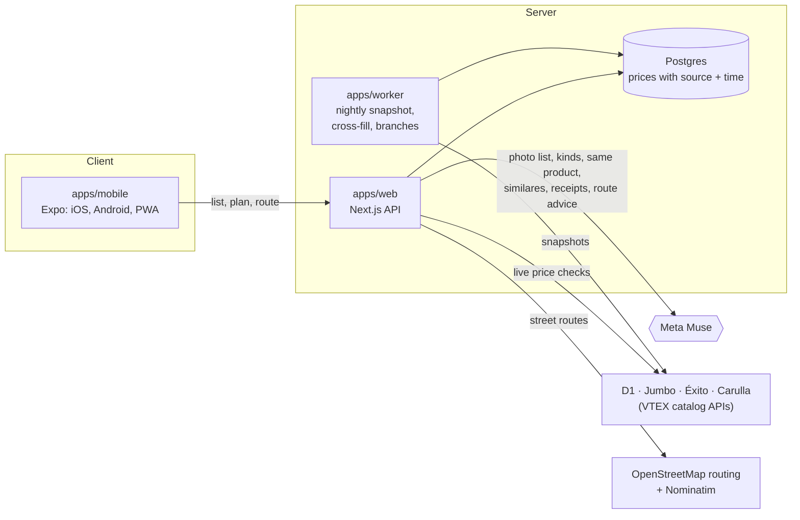

# Rinde

**Your grocery list, at the supermarkets where it costs least.** Rinde is a shopping agent for families in Colombia. You write your list (or photograph it, or forward a supermarket e-invoice). Rinde finds each item at D1, Jumbo, Éxito and Carulla, checks the prices live, and tells you where to buy what, how much you save, and the walk or ride between stores.

Built for the Meta Global AI Developer Hackathon (theme: *Build for Your World*), with **Meta Muse** doing the reasoning and deterministic code doing all the money.

- App (installable PWA): https://app.rinde.cool.chuventures.com
- Landing page: https://rinde.cool.chuventures.com
- API: https://rinde-api.cool.chuventures.com

## What it does

1. **Your list, any way you write it.** Type "3 kilos de arroz, 30 huevos, leche", paste it, or photograph a handwritten list.
2. **The same product at every store.** Products are matched by barcode first. When stores use different barcodes, Muse reads the names and the package photos, decides whether two listings are the same product, and says why. Measured against barcodes, it picked the wrong product 0 times in a held-out test of 95 products ([below](#measured-the-same-product-at-every-store)).
3. **A plan, not a chart.** For example: "D1 for these 12 items, Jumbo for these 3, $189.890, and you save $75.930 against buying everything at Jumbo". You can switch between 1, 2 and 3 stops.
4. **Live checks you can watch.** "Verificando D1… 9/9 ✓" shows each store's prices being re-checked before you leave home.
5. **Over budget? It negotiates.** Rinde proposes another store, another brand, a smaller pack, or dropping an optional item. Each proposal comes with its exact saving. Nothing changes until you accept.
6. **The trip.** You pick the supermarket you usually go to. Rinde works out whether one extra stop is worth it on foot, by bus, by moto or by car, using real street routes. It draws the route on a map, gives Spanish turn-by-turn directions, and hands off to Google Maps or Waze.
7. **Receipts make prices better.** Photograph a receipt, or forward a DIAN e-invoice email. Muse reads the lines, you confirm them, and they become fresh in-store prices, with points for you.

## Where Meta Muse is used

The rule: **Muse never produces, sees or adjusts a price.** It reads text and images, judges whether products are the same, and writes advice using only figures the code computed. Every price on screen comes from a stored observation with its store, source URL and time.

| Step | Muse does | Code |
|---|---|---|
| List from a photo | Reads a handwritten or printed list into items and amounts | `apps/web/src/server/list-photo.ts` |
| What an item means | Keeps the store products a shopper would accept for "leche" or "arroz" (plain milk, not flavored), before the optimizer picks the cheapest | `apps/web/src/server/kind-judge.ts` |
| Same product, different barcode | Judges whether a listing at another store is the same product (brand, size, variety, packaging, store naming), from the names and the stores' product photos, with a one-line reason, or says it can't tell | `apps/web/src/server/same-product.ts` |
| Similar products | Groups other brands of the same kind, compared by price per kg, L or unit, and labeled as a different product | `apps/web/src/server/value-groups.ts` |
| Receipts | Reads store, date and lines from a receipt photo; matches abbreviated lines ("LCHE ENT ALP") to catalog products | `apps/web/src/server/muse.ts` |
| Route advice | Explains which route option suits the person, or asks one question ("¿vas con bebé?"). Every number it writes is checked against the given figures, and it falls back to a rule if one isn't | `apps/web/src/server/route-advice.ts` |

Model: `muse-spark-1.3` through the Meta Model API (`META_API_KEY`). When Muse is unavailable, every step degrades to a deterministic rule, so a plan never fails because of the model.

### Measured: the same product at every store

This is the step where a wrong answer costs the shopper most: if Muse says two listings are the same product when they aren't, Rinde shows one product's price for another. So it is the step we measure.

**The problem.** Each store names products its own way, and often uses its own barcode. Jumbo's "Café Quindío Buenavista Molido x340 grs" is Carulla's "Café CAFE QUINDIO molido especial origen (340 gr)". Éxito and Carulla call three different Karavansay flours just "Harina Karavansay precocida". Milk in a bag and milk in a carton have the same name and size and different prices.

**How it works** (`judgeSameProduct` in `apps/web/src/server/same-product.ts`):

1. **Code narrows the field.** Only the store's listings with the same size (converted to g, ml or units, same pack count) and the same brand are candidates. Muse never chooses among anything else.
2. **Muse reads the names.** It gets the shopper's product and the numbered candidates: names, brands and sizes, never a price. The prompt spells out what makes products different (variety, line, flavor, formula, packaging when both names state it) and what doesn't (store abbreviations, describing words like "tradicional" or "esparcible").
3. **Muse looks at the packages.** When two or more candidates could be it, the same call also carries the stores' own product photos, made small (400 px) by the stores' image server: the shopper's product and each candidate. The label on the package settles what the names can't.
4. **Three possible answers.** The candidate's number, "none" (-1), or "not sure" (-2) when names and photos fit more than one listing. Each comes with a one-line reason in Spanish that the app shows: *"La foto del comprador es la galleta morada de frutos rojos, no la verde de manzana."* "Not sure" shows no price for that store and says why, instead of guessing.
5. **Code checks the answer.** A pick that fails the size and brand checks again is thrown away. A match is stored as a `ProductMatch` row with Muse's reason, so it can be seen and undone. Verdicts are cached for 6 hours. Without Muse, a strict word rule decides, and when it can't, the store stays "No pudimos revisar".

**The answer key.** Products that two stores sell under the same barcode tell us the right answer without anyone labeling it. We hide the barcode, give Muse the other store's candidates (the same pool the app builds), and score its answer. "Find" cases have the product in the list. "None" cases have it removed, and the right answer is "none". There are two sets: a tuning set of 120 cases, and a held-out set of 95 cases built from other products.

| | Tuning set: correct | Wrong products picked | Held-out set: correct | Wrong products picked | Median time |
|---|---|---|---|---|---|
| Word rule (no AI) | 57.5 % | 1 | 44.2 % | 0 | instant |
| Muse, names only | 89.2 % | 4 | 84.2 % | 4 | 2.0 s |
| **Muse, names and package photos (shipped)** | **99.2 %** | **1**\* | **97.9 %** | **0** | 2.8 s |

\* A person had already reviewed it as Muse being right: the same aguardiente, sold under another barcode.

The word rule rarely picks a wrong product because it rarely picks anything: it finds 34 to 38 % of the products. Muse finds 97 to 100 %.

**What the photos fixed.** These are Muse's own reasons on cases where it had the names wrong, or said "not sure", before it could see the packages:

| Shopper's product | Muse with the photos |
|---|---|
| Harina Karavansay precocida, 500 g (Carulla) | *"Misma harina de quinua Karavansay precocida de 500 g; la tienda la nombra solo como quinua"* |
| Galletas McVitie's de fruta, 174 g (Carulla) | *"La foto del comprador es la galleta morada de frutos rojos, igual a la del listado 1, no la verde de manzana"* |
| Leche Colanta entera, 1 L (Carulla) | *"La tuya es entera en bolsa, la 0 es entera en caja Tetrapak y la 1 es descremada"*: none of them, so no wrong price |
| Harina Bio Plaza de yuca, 500 g (Éxito) | *"Misma tapioca (almidón de yuca) Bio Plaza de 500 g; ambas fotos dicen TAPIOCA ALMIDÓN DE YUCA"* |

**Being honest about the numbers.**
- Two stores often show the same manufacturer photo, which makes a case easy. About 4 in 10 "find" cases have near-identical photos. On the cases where the two stores' photos look different, the gain holds: 41 to 47 of 47 on the tuning set, and 35 to 40 of 42 on the held-out set.
- The prompt rules and the photo step were chosen after looking at both sets, so the held-out set is no longer unseen.
- The two held-out misses are fair ones: a tamarind the stores list under different brands, and sardines "picantes en tomate" against plain "tomate".

The full reports, with every case Muse got wrong, are in `apps/web/eval/RESULTS.md` and `apps/web/eval/RESULTS-heldout.md`. Each step of the tuning, with its numbers, is in `apps/web/eval/TUNING.md`. To run it again: `MUSE_EVAL=1 INTEGRATION=1 npx vitest run src/server/eval` in `apps/web` (add `MUSE_EVAL_SET=heldout` for the second set).

## Architecture



| Package | What it holds |
|---|---|
| `apps/mobile` | The only client: Expo SDK 58, iOS, Android and web (served as the PWA) |
| `apps/web` | API only (Next.js 16): plans, catalog, route plans, receipts, accounts |
| `apps/worker` | Scheduled jobs: price snapshots, cross-store barcode fill, store branch import |
| `apps/landing` | Marketing page with a live price comparison |
| `packages/core` | Deterministic logic: optimizer, trade-offs, unit math, route costs |
| `packages/retailers` | Store clients: VTEX search, sizes, pacing |
| `packages/routing` | OSRM client with caching and polite retries |
| `packages/db` | Prisma schema and migrations |

The optimizer, trade-offs, pack-size math and all totals live in `packages/core` and are unit-tested. `docs/demo-baseline.md` hand-checks a 15-item family list against the database.

## Running it

Requirements: Node 20.9+, pnpm 10, Docker.

```bash
pnpm install
cp .env.example .env            # fill in DATABASE_URL; META_API_KEY to use Muse
docker compose -f docker-compose.dev.yml up -d   # Postgres on localhost:5433
pnpm db:deploy                  # apply migrations
pnpm ingest                     # take a price snapshot (a few minutes)
pnpm dev                        # API on :3000, worker, landing page
EXPO_PUBLIC_API_URL=http://localhost:3000 pnpm --filter @rinde/mobile web   # the app in a browser
```

Without `META_API_KEY`, the app runs on its rule fallbacks, and `DEMO_RECEIPTS=1` serves recorded receipts.

## Tests

```bash
pnpm typecheck
pnpm test                                       # unit tests
INTEGRATION=1 pnpm --filter @rinde/web test     # against the dev database
# Muse's same-product accuracy against barcodes (needs META_API_KEY and the dev database), in apps/web:
MUSE_EVAL=1 INTEGRATION=1 npx vitest run src/server/eval
E2E_BASE_URL=https://app.rinde.cool.chuventures.com pnpm e2e
```

`pnpm e2e` drives the real app in headless Chrome as two shoppers:

- one plans their list at their usual D1;
- one splits an 8-item list across stores to save, then plans a walk from their Carulla to a D1.

It checks that every product matches what was asked for, that totals add up, and that the route, map and Google Maps hand-off work.

## Data and its limits

- **Prices are snapshots plus live checks.** The worker stores each store's staples catalog nightly. Before a plan is shown, the chosen products are re-checked live. A price that couldn't be checked is labeled with its date, and dropped after 36 hours.
- **Requests are slow and polite.** They go one at a time, with pauses (5 s between requests to Grupo Éxito), and back off for minutes after any 429. D1 and Jumbo see a `RindeBot` User-Agent. Grupo Éxito (Éxito and Carulla) refuses every request with that User-Agent, so those two get a browser User-Agent. A price that couldn't be checked live uses the latest stored one and says so.
- **Routes come from OpenStreetMap.** Bus times are estimates from the car route (×1.6 plus waits), labeled "estimado, sin horarios".
- **No invented numbers.** Savings are always against a stated baseline ("comprar todo en Jumbo, sin cambios de marca"), over the items both options price.
