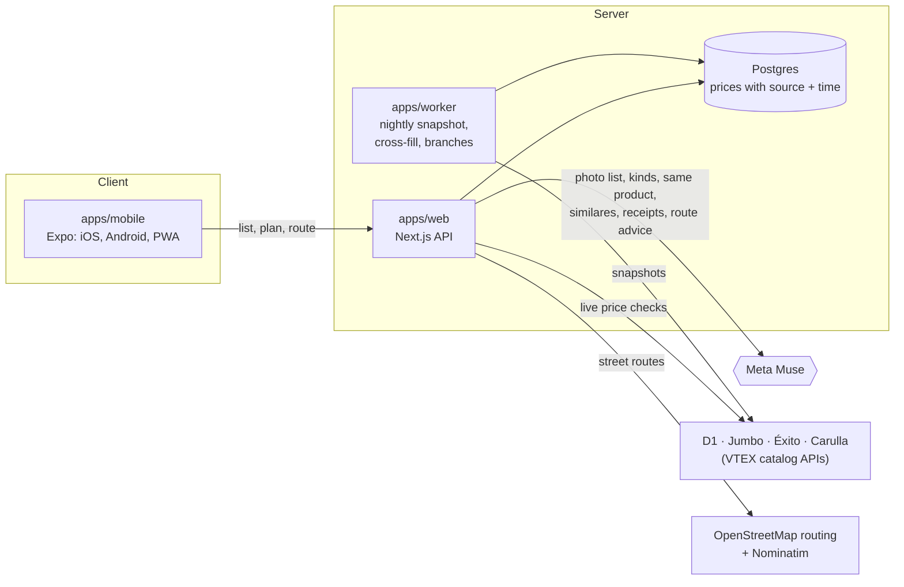

# Rinde

**Your grocery list, at the supermarkets where it costs least.** Rinde is a shopping agent for families in Colombia. You write your list (or photograph it, or forward a supermarket e-invoice). Rinde finds each item at D1, Jumbo, Éxito and Carulla, checks the prices live, and tells you where to buy what, how much you save, and the walk or ride between stores.

Built for the Meta Global AI Developer Hackathon (theme: *Build for Your World*), with **Meta Muse** doing the reasoning and deterministic code doing all the money.

- App (installable PWA): https://app.rinde.cool.chuventures.com
- Landing page: https://rinde.cool.chuventures.com
- API: https://rinde-api.cool.chuventures.com

## What it does

1. **Your list, any way you write it.** Type "3 kilos de arroz, 30 huevos, leche", paste it, or photograph a handwritten list.
2. **The same product at every store.** Products are matched by barcode first. When stores use different barcodes, Muse decides whether two listings are the same product, and says why.
3. **A plan, not a chart.** For example: "D1 for these 12 items, Jumbo for these 3, $189.890, and you save $75.930 against buying everything at Jumbo". You can switch between 1, 2 and 3 stops.
4. **Live checks you can watch.** "Verificando D1… 9/9 ✓" shows each store's prices being re-checked before you leave home.
5. **Over budget? It negotiates.** Rinde proposes another store, another brand, a smaller pack, or dropping an optional item. Each proposal comes with its exact saving. Nothing changes until you accept.
6. **The trip.** You pick the supermarket you usually go to. Rinde works out whether one extra stop is worth it on foot, by bus, by moto or by car, using real street routes. It draws the route on a map, gives Spanish turn-by-turn directions, and hands off to Google Maps or Waze.
7. **Receipts make prices better.** Photograph a receipt, or forward a DIAN e-invoice email. Muse reads the lines, you confirm them, and they become fresh in-store prices, with points for you.

## Where Meta Muse is used

The rule: **Muse never produces, sees or adjusts a price.** It reads text and images, judges whether products are the same, and writes advice using only figures the code computed. Every price on screen comes from a stored observation with its store, source URL and time.

| Step | Muse does | Code |
|---|---|---|
| List from a photo | Reads a handwritten or printed list into items and amounts | `apps/web/src/server/list-photo.ts` |
| What an item means | Keeps the store products a shopper would accept for "leche" or "arroz" (plain milk, not flavored), before the optimizer picks the cheapest | `apps/web/src/server/kind-judge.ts` |
| Same product, different barcode | Judges whether a listing at another store is the same product (brand, size, variety, store naming), with a one-line reason | `apps/web/src/server/same-product.ts` |
| Similar products | Groups other brands of the same kind, compared by price per kg, L or unit, and labeled as a different product | `apps/web/src/server/value-groups.ts` |
| Receipts | Reads store, date and lines from a receipt photo; matches abbreviated lines ("LCHE ENT ALP") to catalog products | `apps/web/src/server/muse.ts` |
| Route advice | Explains which route option suits the person, or asks one question ("¿vas con bebé?"). Every number it writes is checked against the given figures, and it falls back to a rule if one isn't | `apps/web/src/server/route-advice.ts` |

Model: `muse-spark-1.3` through the Meta Model API (`META_API_KEY`). When Muse is unavailable, every step degrades to a deterministic rule, so a plan never fails because of the model.

## Architecture



| Package | What it holds |
|---|---|
| `apps/mobile` | The only client: Expo SDK 58, iOS, Android and web (served as the PWA) |
| `apps/web` | API only (Next.js 16): plans, catalog, route plans, receipts, accounts |
| `apps/worker` | Scheduled jobs: price snapshots, cross-store barcode fill, store branch import |
| `apps/landing` | Marketing page with a live price comparison |
| `packages/core` | Deterministic logic: optimizer, trade-offs, unit math, route costs |
| `packages/retailers` | Store clients: VTEX search, sizes, pacing |
| `packages/routing` | OSRM client with caching and polite retries |
| `packages/db` | Prisma schema and migrations |

The optimizer, trade-offs, pack-size math and all totals live in `packages/core` and are unit-tested. `docs/demo-baseline.md` hand-checks a 15-item family list against the database.

## Running it

Requirements: Node 20.9+, pnpm 10, Docker.

```bash
pnpm install
cp .env.example .env            # fill in DATABASE_URL; META_API_KEY to use Muse
docker compose -f docker-compose.dev.yml up -d   # Postgres on localhost:5433
pnpm db:deploy                  # apply migrations
pnpm ingest                     # take a price snapshot (a few minutes)
pnpm dev                        # API on :3000, worker, landing page
EXPO_PUBLIC_API_URL=http://localhost:3000 pnpm --filter @rinde/mobile web   # the app in a browser
```

Without `META_API_KEY`, the app runs on its rule fallbacks, and `DEMO_RECEIPTS=1` serves recorded receipts.

## Tests

```bash
pnpm typecheck
pnpm test                                       # unit tests
INTEGRATION=1 pnpm --filter @rinde/web test     # against the dev database
E2E_BASE_URL=https://app.rinde.cool.chuventures.com pnpm e2e
```

`pnpm e2e` drives the real app in headless Chrome as two shoppers:

- one plans their list at their usual D1;
- one splits an 8-item list across stores to save, then plans a walk from their Carulla to a D1.

It checks that every product matches what was asked for, that totals add up, and that the route, map and Google Maps hand-off work.

## Data and its limits

- **Prices are snapshots plus live checks.** The worker stores each store's staples catalog nightly. Before a plan is shown, the chosen products are re-checked live. A price that couldn't be checked is labeled with its date, and dropped after 36 hours.
- **Requests are polite and identified.** They go one at a time, with pauses and a `RindeBot` User-Agent. Grupo Éxito (Éxito and Carulla) currently refuses that User-Agent from our server, so their lines use the latest stored price and say so.
- **Routes come from OpenStreetMap.** Bus times are estimates from the car route (×1.6 plus waits), labeled "estimado, sin horarios".
- **No invented numbers.** Savings are always against a stated baseline ("comprar todo en Jumbo, sin cambios de marca"), over the items both options price.
